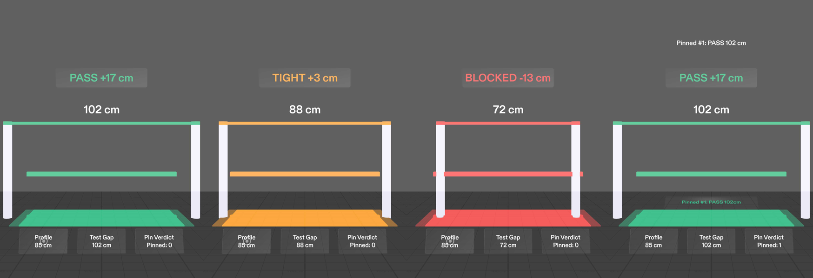
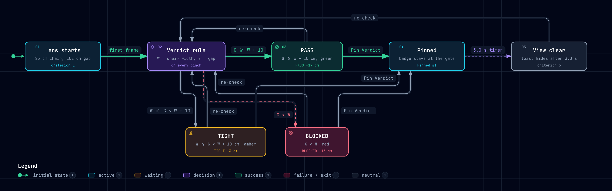
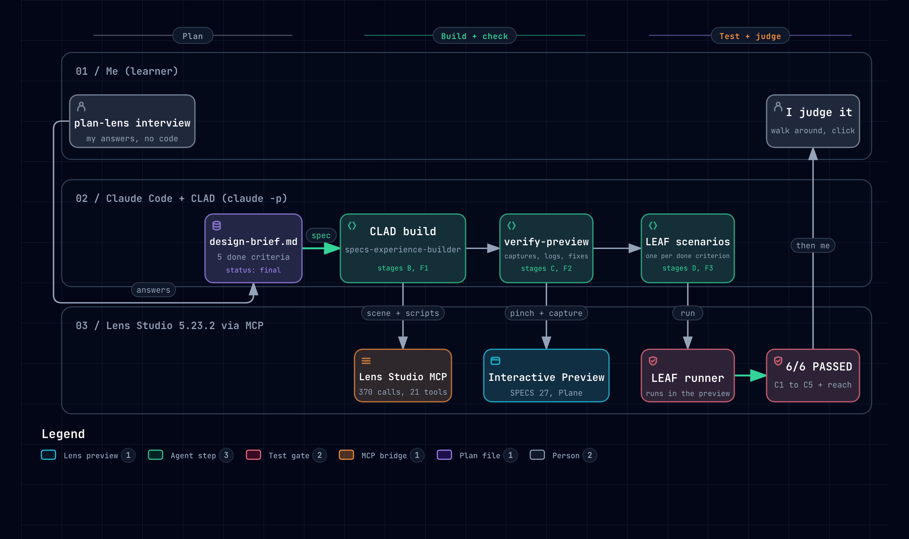

# CurbClear AR

**A 1:1 clearance gate on the floor, for Snap Spectacles.** Before a wheelchair user rolls into a doorway or between two bollards, the Lens shows on the real floor ahead whether the gap fits their chair.



> **Honest scope.** Everything here runs in the **Lens Studio 5.23.2 Preview** (device SPECS 27, Interactive Preview). It has not run on real Spectacles yet, and nothing is measured: the gap widths are stand-ins that you step through with a button.

- Demo video (2:28): https://youtu.be/uyuuZq2TPGQ
- Devpost: _link added after submission_
- Built for **Learn AR with SPECS** (Devpost, 2026)

## What it does

| | |
|---|---|
| **Gate on the floor** | A real-size gate rests on the floor 2.0 m ahead. Two white posts (55 cm tall) mark the gap. A floor corridor is exactly as wide as your chair. |
| **One rule** | `W` = chair width, `G` = gap. **PASS** if `G >= W + 10 cm` (5 cm each side). **TIGHT** if `W <= G < W + 10 cm`. **BLOCKED** if `G < W`. |
| **One color** | The corridor, the post caps, the dimension line and a 3-word pill such as `PASS +17 cm` take the verdict color: green `#10B981`, amber `#F59E0B`, red `#EF4444`. A live label shows the gap (`102 cm`). |
| **Three big buttons** | A pinch dock at 1.1 m, low in the view, three buttons of 15 x 7.5 cm: **Profile** (85, 95, 75 cm), **Test Gap** (102, 88, 72, 80 cm), **Pin Verdict** (leaves a badge at the gate; the confirmation note hides after 3.0 s). |
| **Eye level stays clear** | No panels in the central band. The pill floats above the gate, the dock sits below it. |

## Who it is for

Wheelchair users (manual and power chairs), and the accessibility auditors who check doorways, bollards and sidewalks for them. Both hands are on the push rims, so checking with a phone or a tape measure means stopping. Glasses can draw the exact width of your chair on the real floor, at the place where you have to decide.

## How it decides

<picture>
  <source media="(prefers-color-scheme: light)" srcset="docs/media/how-it-decides-light.png">
  
</picture>

The rule lives in one pure function, `computeVerdict` in [`Assets/Scripts/CurbClearLogic.ts`](Assets/Scripts/CurbClearLogic.ts). The scene scripts only draw its result. At an 80 cm gap the three chairs give three answers: 75 cm is TIGHT (+5 cm), 85 cm is BLOCKED (-5 cm), 95 cm is BLOCKED (-15 cm).

## Open it in Lens Studio 5.23.2

1. Install **Lens Studio 5.23.2** from [ar.snap.com/download/v5-23-2](https://ar.snap.com/download/v5-23-2). Other versions are untested: the project uses Spectacles Interaction Kit 0.18 and Leaf 2.0.2, which match 5.23.2.
2. Clone this repo and open `CurbClearAR.esproj`.
3. In the Preview panel: device **SPECS 27**, environment **Plane**, **Interactive Preview** on. A mouse click counts as a pinch.
4. Click **Profile**, **Test Gap** and **Pin Verdict**. The Logger prints one `[CurbClear] STATE ...` line per change, for example `STATE profile=85 gap=88 verdict=TIGHT margin=3 pinned=0 pill="TIGHT +3 cm"`.
5. To run the tests, open the LEAF panel and run the six `curbclear-*` scenarios.

## Plan: the design brief

[`devpost/design-brief.md`](devpost/design-brief.md) was written by the **plan-lens** skill (Devpost Learn skill pack) from my interview, before any code. It fixes one spatial moment, every position in cm, the verdict rule, five done criteria that can be checked in the Preview, and the open risks. Its status is `final` and it matches the build.

## Build: CLAD in Claude Code, over the Lens Studio MCP

<picture>
  <source media="(prefers-color-scheme: light)" srcset="docs/media/how-it-was-built-light.png">
  
</picture>

Claude Code built the Lens with the **CLAD** plugin (`ls-clad`, agent `specs-experience-builder`) and drove Lens Studio through its **MCP** server. I gave design notes, not code. Each stage was a fresh headless `claude -p` session in this folder. The numbers below are counted from the session logs.

| Stage | What happened | Agent time |
|---|---|---|
| plan-lens | design brief from the interview | 45 s |
| Build | scene objects and six TypeScript scripts | 18 min |
| Package fixes | newest LEAF needs Lens Studio 5.25, so Leaf 2.0.2 and preview tools 2.0.1 were installed | 4 min |
| verify-preview | captures showed the gate was not drawn; fixed | 3.5 min |
| LEAF | five done criteria plus a reach test written and run | 4.4 min |
| Evidence | step-by-step Preview captures, log checked after each press | 2.4 min |
| Polish | final layout: gate at 2.0 m, 55 cm posts, gap label, 15 x 7.5 cm buttons | 15 min |
| verify-preview | toast moved above the pill, badge enlarged | 8.6 min |
| LEAF final | assertions set to the final values, 6/6 | 5.1 min |

Totals: **12 sessions, about 62 minutes of agent time, 370 Lens Studio MCP tool calls across 21 tools.** By hand I clicked *Trust and Load* once for the LEAF plugin and did one *File > Save* plus *Reload Project* after a package swap.

What we learned along the way:

- The SPECS 27 Preview frame is narrow (about ±16° across). At 1.5 m a 102 cm gap did not fit, so the gate moved to 2.0 m.
- Black is transparent on the additive display, so every label is bright and nothing relies on dark UI.
- A floor gate plus a low dock leaves the middle of the view clear. Restraint was the hard part.

## Tests: LEAF, 6 of 6 passed

Final run, Lens Studio Logger, 2026-11-08:

| Scenario | Checks (done criterion) | Time | Result |
|---|---|---|---|
| `curbclear-c1-initial-state` | gate at (0, -45, -200) cm, 85 cm chair, 102 cm gap, PASS, no panels at eye level | 1.565 s | PASSED |
| `curbclear-c2-profile-cycle` | Profile cycles 85, 95, 75, 85 cm and resizes the frame | 3.414 s | PASSED |
| `curbclear-c3-gap-cycle` | 102 PASS green, 88 TIGHT amber, 72 BLOCKED red, posts and label follow | 4.326 s | PASSED |
| `curbclear-c4-cross-check` | at 80 cm: 75 TIGHT +5, 85 BLOCKED -5, 95 BLOCKED -15 | 8.448 s | PASSED |
| `curbclear-c5-pin-verdict` | Pin counts up, badge updates, the note hides after 3.0 s | 7.832 s | PASSED |
| `curbclear-ik-reachability` | a simulated arm (IK avatar) reaches and presses Profile and Pin Verdict | 13.476 s | PASSED |

No error lines were logged during that run.

## What is proven, and what is not

| Logic proven (Preview + LEAF) | Feel unproven (needs real Spectacles) |
|---|---|
| the verdict rule and all five done criteria | measuring a real gap (there is no depth sensing yet) |
| 1:1 sizes, as scene units in cm | comfort of a floor gate 2 m ahead, and focus between 1.1 m and 2 m |
| a simulated arm reaches the dock | real hand tracking and pinch |

**Next:** real depth sensing on Spectacles to measure the gap, then a test on a real sidewalk.

## Project layout

```
Assets/Scripts/
  CurbClearLogic.ts        verdict rule, profile and gap tables, state, self-test (no Lens Studio APIs)
  CurbClearMain.ts         wiring: dock events -> state -> views, 3.0 s note timer
  CurbClearGateView.ts     floor gate: corridor, posts, caps, dimension line, gap label
  CurbClearVerdictUI.ts    verdict pill
  CurbClearDockUI.ts       three pinch buttons (Spectacles UI Kit) and the note
  CurbClearBadgeUI.ts      pinned badge at the gate
  CurbClearC1..C5Scenario.ts, CurbClearIKScenario.ts, CurbClearLeafHelpers.ts, LeafIndex.ts   LEAF tests
devpost/design-brief.md    the plan
docs/media/                README images (Preview captures and archify diagrams)
Packages/                  Spectacles Interaction Kit, Spectacles UI Kit, Leaf 2.0.2, preview tools 2.0.1
```

## Built with

Lens Studio 5.23.2 · Spectacles Interaction Kit · Spectacles UI Kit · LEAF · CLAD (`ls-clad`) · Lens Studio MCP · Claude Code · plan-lens (Devpost Learn skill pack) · TypeScript

All scripts and tests in this repo were written during the hackathon, by CLAD sessions working from the brief. The idea of checking sidewalk clearance comes from an earlier phone concept of mine; no code from it is used here. The project started from the Lens Studio Specs Base Template.
